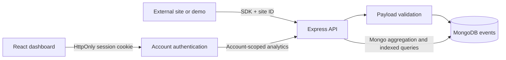

# InsightFlow — User Analytics Platform

InsightFlow is a small, full-stack analytics demo that collects page views and click coordinates through a framework-independent browser SDK and displays them in a React dashboard. It is designed to make first-party event collection easy to inspect: session summaries, a chronological journey, and click positions mapped to the viewport where each interaction happened.

## Problem and features

Web teams need to understand which pages visitors see and where they interact. This project demonstrates an embeddable tracker, a validated ingestion API, query-friendly event storage, and a dashboard backed by actual event records. It includes a demo storefront so the full collection flow can be exercised without modifying another website.

- An independent, fail-silent JavaScript SDK with session persistence and 30-minute inactivity expiry.
- `page_view` and document-level `click` events with ISO timestamps and viewport dimensions.
- MongoDB-backed APIs for overview metrics, paginated sessions, chronological session events, and page click data.
- Email/password account creation, secure sign-in, account settings, and password recovery.
- Private analytics per account, routed by a unique site ID in each account’s tracker snippet.
- Responsive overview, sessions list, session journey, and viewport-normalized click heatmap.
- A demo e-commerce storefront with interactive product buttons.
- A 50-product demo catalog with category filters, search, and a working persistent shopping bag.
- Payload validation, a 16 KB body limit, ingestion rate limiting, Helmet headers, environment-based CORS, and centralized errors.

## Technology

React 18, Vite, JavaScript, Tailwind CSS, React Router, Recharts, Lucide React, Axios, date-fns, responsive CSS; Node.js 20+, Express 4, MongoDB, Mongoose, dotenv, Helmet, cors, express-rate-limit, Nodemailer, and Node.js scrypt; Vitest, Testing Library, Node test runner, and Supertest.

## Architecture



### Project structure

```text
client/             React dashboard, routes, API client, tests
client/src/auth/    Auth context and protected dashboard routes
client/tailwind.config.js  Tailwind content scan and design token
server/src/config/   MongoDB connection
server/src/models/   Mongoose Event model and indexes
server/src/models/User.js  Separate account records, login sessions, reset tokens
server/src/routes/   REST route definitions and ingestion rate limit
server/src/controllers/ HTTP request / response handlers
server/src/services/ MongoDB queries and aggregation pipelines
server/src/validators/ Event allow-list and validation
server/src/middleware/ Centralized errors and 404 handling
tracker/            Standalone embeddable SDK and integration notes
demo/               Demo storefront served by the API
```

### Event schema and indexes

Each event stores `account_id` (User reference), `session_id` (string), `event_type` (`page_view` or `click`), `page_url`, `timestamp` (Date), optional `properties`, and `createdAt`. Click properties are `x`, `y`, `viewport_width`, and `viewport_height`; page views may include a bounded page title. The tracker sends a public `site_id` that resolves to its account before an event is stored. Account details are stored separately from events. Passwords use Node.js scrypt with a unique salt; login sessions and reset tokens are stored only as hashes.

Indexes:

- `{ account_id: 1, session_id: 1, timestamp: 1 }` serves account-scoped chronological session retrieval.
- `{ account_id: 1, timestamp: -1 }` supports per-account recent activity and time-window reads.
- `{ account_id: 1, page_url: 1, event_type: 1, timestamp: -1 }` serves per-account page click queries and heatmaps.
- Unique indexes on User email and tracker ID enforce account and site ID uniqueness.

Session rows are derived from event records using `$group` and `$facet`, with pagination performed in MongoDB. This avoids a separately maintained, potentially inconsistent sessions collection. The overview also uses database aggregations for counts, daily activity, and top pages.

## API

All responses use `{ "success": boolean, "data"?: ..., "error"?: { "message": string } }`.

| Method and path | Purpose |
| --- | --- |
| `POST /api/auth/signup` | Create an account with name, email, and a 12–128 character password; signs the account in. |
| `POST /api/auth/login` | Sign in and set an HttpOnly session cookie. |
| `POST /api/auth/logout` | Revoke the current login session. |
| `GET /api/auth/me` | Return signed-in account details and tracker ID. |
| `PATCH /api/auth/profile` | Update the display name or change password with current-password confirmation. |
| `POST /api/auth/forgot-password` | Request a reset email; response does not reveal whether the account exists. |
| `POST /api/auth/reset-password` | Set a new password with a single-use reset token (expires after 30 minutes). |
| `POST /api/events` | Validate and store an event (`201`); pass `site_id` to associate it with an account. |
| `GET /api/overview` | Account-scoped totals, daily counts, top pages, and recent events (requires sign-in). |
| `GET /api/sessions?page=1&limit=20&sort=last_event_at&order=desc&search=` | Account-scoped session counts, sorted and paginated (requires sign-in). |
| `GET /api/sessions/:sessionId/events?page=1&limit=100` | Chronological events for an account-owned session (requires sign-in). |
| `GET /api/heatmap` | Account-owned page URLs with click activity (requires sign-in). |
| `GET /api/heatmap?page_url=https%3A%2F%2Fshop.example%2Fproducts` | Account-scoped click count and up to 5,000 click positions (requires sign-in). |
| `GET /api/health` | API and MongoDB readiness; status `503` while disconnected. |

Example ingestion request:

```bash
curl -X POST http://localhost:5000/api/events \
  -H 'Content-Type: application/json' \
  -d '{"session_id":"demo-session","site_id":"your-tracker-id","event_type":"click","page_url":"http://localhost:5000/demo/","timestamp":"2026-11-26T12:00:00.000Z","properties":{"x":320,"y":240,"viewport_width":1440,"viewport_height":900}}'
```

Successful ingestion returns `201` with `{ "success": true, "data": { "id": "<event-id>" } }`. A missing session identifier returns `400` with `{ "success": false, "error": { "message": "session_id must be a non-empty string up to 128 characters." } }`.

## Run locally

Requirements: Node.js 20+, npm, and MongoDB running locally or a MongoDB connection URI. There are no bundled credentials.

1. Copy `.env.example` to `.env` in the repository root.
2. Set `MONGODB_URI` to your local MongoDB URI or an authorized MongoDB deployment URI.
3. Install and start both workspaces from the root:

```bash
npm install
npm run dev
```

The dashboard is at `http://localhost:5173`, the API at `http://localhost:5000`, and the demo storefront at `http://localhost:5000/demo/`. The API exits with a clear message if MongoDB is not reachable at startup. `npm run dev:server` and `npm run dev:client` can also run the services separately.

## Environment variables

| Variable | Description | Default |
| --- | --- | --- |
| `PORT` | Express port | `5000` |
| `NODE_ENV` | Runtime environment | `development` |
| `MONGODB_URI` | MongoDB connection string | `mongodb://127.0.0.1:27017/insightflow` |
| `CORS_ORIGINS` | Comma-separated allowed origins | local dashboard and API origins |
| `VITE_API_URL` | API base URL used by Vite dashboard | `http://localhost:5000/api` |
| `VITE_DEMO_URL` | Demo storefront URL opened by dashboard links | `http://localhost:5000/demo/` |
| `VITE_BRAND_NAME` | Dashboard wordmark | `InsightFlow` |
| `MONGODB_TEST_URI` | Optional isolated database for the ingestion/query integration test | unset |
| `CLIENT_ORIGIN` | Public dashboard origin used in reset links | `http://localhost:5173` |
| `SMTP_HOST`, `SMTP_PORT`, `SMTP_SECURE` | SMTP server for password recovery emails | unset, `587`, `false` |
| `SMTP_USER`, `SMTP_PASS`, `MAIL_FROM` | Optional SMTP credentials and sender address | unset |

For a deployed dashboard, set `VITE_API_URL` to the reachable API base and include the dashboard and any tracked site origins in `CORS_ORIGINS`. Configure SMTP for recovery email, set `CLIENT_ORIGIN` to the deployed dashboard origin, and serve the dashboard/API on HTTPS so session cookies can use the Secure flag. Do not set `CORS_ORIGINS=*` for a public production deployment.

## Add the tracker

The demo page already installs the SDK. For another site, set the absolute public API URLs:

```html
<script src="https://your-api.example/tracker/insightflow.js"
        data-api-url="https://your-api.example/api/events"
        data-site-id="your-tracker-id" defer></script>
```

Copy the account-specific snippet from **Account settings → Website tracking**. The `data-site-id` associates incoming events with that account and is a public routing identifier, not a password. The demo store also reads `site_id` from its URL so dashboard preview links send events to the signed-in account.

On initial load, the SDK records one page view. Document clicks include viewport-relative `clientX` / `clientY`, viewport width and height, full page URL, and an ISO timestamp. It stores a UUID and last activity in localStorage; after 30 minutes without an event, it starts a new session. With storage blocked, it uses an in-memory session. Requests are best effort, use keepalive, and use `sendBeacon` while the document is hidden. A failed request does not retry indefinitely or interrupt the page. Mark a region `data-insightflow-ignore` to suppress its clicks.

### Accounts and password recovery

The dashboard requires an account. Use **Create an account** with your name, email, and a password of at least 12 characters. Each account gets a unique tracker ID; dashboard API reads filter by that ID’s account. Public website events only attach to the account when their tracker sends a valid `site_id`.

For local development, request a password reset from **Forgot password?**. With no SMTP host configured and `NODE_ENV=development`, the API prints a single-use reset link to the backend terminal. In deployment, configure the SMTP variables above and set `CLIENT_ORIGIN` to the dashboard’s HTTPS origin. Reset links expire after 30 minutes and password reset signs out existing sessions.

### Try the demo flow

1. Start MongoDB, then `npm run dev`.
2. Open the demo storefront at `http://localhost:5000/demo/` and click product cards, navigation, and add-to-bag buttons.
3. Open `http://localhost:5173/sessions` to see the session and `http://localhost:5173/heatmap` to inspect clicks on the demo URL.
4. Check readiness with `http://localhost:5000/api/health`.

## Testing

```bash
npm test
npm run build
```

The tests cover input validation, password hashing, auth-gated dashboard routes, tracker page views/clicks and session expiry, and dashboard empty/error states. The Mongo-backed ingestion, account isolation, session history, and heatmap integration test runs when `MONGODB_TEST_URI` points to a dedicated test database. A complete browser flow should be run locally after configuring MongoDB.

## Requirement review

| Assignment requirement | Implementation location | Verification method | Status |
| --- | --- | --- | --- |
| Account creation, login, logout, profile settings, password recovery | `server/src/controllers/authController.js`, `client/src/pages/AuthPages.jsx`, `client/src/pages/AccountSettings.jsx` | Auth API and UI tests; local SMTP reset walkthrough | Implemented; email delivery needs SMTP configuration |
| Separate per-account analytics | `server/src/models/User.js`, `server/src/models/Event.js`, `server/src/services/eventService.js` | Mongo integration test with two accounts | Implemented; Mongo integration test requires `MONGODB_TEST_URI` |
| Reusable SDK: session, page view, click, coordinates, timestamps, best-effort delivery | `tracker/insightflow.js` | Node SDK tests | Implemented; unit tests pass |
| Event validation, persistence, session aggregates, event history, heatmap, health | `server/src/` | Supertest suite and Mongo-backed manual flow | Implemented; DB-backed flow not run here |
| MongoDB event schema and indexes | `server/src/models/Event.js` | Mongoose model review | Implemented |
| Overview metrics and activity charts from collected data | `server/src/services/eventService.js`, `client/src/pages/Overview.jsx` | API-backed dashboard; empty state test | Implemented |
| Searchable sessions and chronological journey | `client/src/pages/Sessions.jsx`, `client/src/pages/SessionDetail.jsx` | Dashboard tests and browser flow | Implemented |
| Viewport-normalized click heatmap and density | `client/src/pages/Heatmap.jsx`, `client/src/heatmap.css` | Review coordinate calculation; browser flow | Implemented |
| Demo storefront with installed SDK | `demo/` | Open `/demo/`, inspect session and heatmap | Implemented; end-to-end run pending MongoDB |
| Responsive dashboard, loading/empty/error states | `client/src/` | Vitest tests and visual browser review | Implemented |
| Setup, API, schema, trade-offs, deployment notes | `README.md`, `tracker/README.md` | Documentation review | Implemented |
| Public GitHub repository and hosted instance | External account configuration | Create repository/deploy with user credentials | Not configured; no remote or hosting credentials provided |

## Assumptions and trade-offs

- Session identity is a first-party random identifier, separate from the authenticated account identity. `lastSeen` advances when the SDK emits an event; a page left idle for 30 minutes receives a new ID on its next event.
- Events are immutable and sessions are derived. High-volume deployments may choose a rollup collection after measuring aggregation cost.
- Heatmap coordinates are normalized independently against each event's captured viewport and rendered on a neutral visualization surface. It is not represented as a screenshot or document-scroll coordinate map.
- Dashboard routes require sign-in, and analytics reads are scoped to each account's tracker ID. Public website ingestion remains open by design; the tracker ID is visible in page source, so add stronger abuse controls before a public production launch. Do not put sensitive or production visitor data in this demo.
- The overview chart uses the latest 14 days. Session and event history pagination is available in the API; the dashboard loads up to the first 500 events for a journey.
- Click sampling, data retention, consent controls, and multi-tenant workspace access are not implemented.

## Screenshots

Capture the overview, sessions list, session journey, and heatmap from the locally running app and add them here before submission. No screenshots are included because this environment has not yet completed a browser run.

## Hosting and GitHub submission

Deployment is not configured in this workspace. To host, provision MongoDB, deploy the API and static React build to services that support Node and static assets, set the environment variables above, allow the dashboard and tracked origins through CORS, and use HTTPS on every public origin. The server serves the SDK and demo at `/tracker/` and `/demo/`; configure your host to serve the built client app and its SPA routes as well.

To submit publicly, create a new GitHub repository under your account, commit the staged files with `git commit -m "Build InsightFlow user analytics platform"`, add it as `origin` with `git remote add origin <your-repository-url>`, and push using `git push -u origin main`. This workspace has been initialized as a local Git repository with the project files staged. No remote, GitHub credentials, or hosting credentials were provided here, so publishing must be done from an environment with access to your GitHub account.

## Future improvements

Add email verification, consent and configurable retention policies, stronger public-ingestion abuse controls, more robust retry queues, configurable date ranges, and efficient heatmap cell aggregation.
